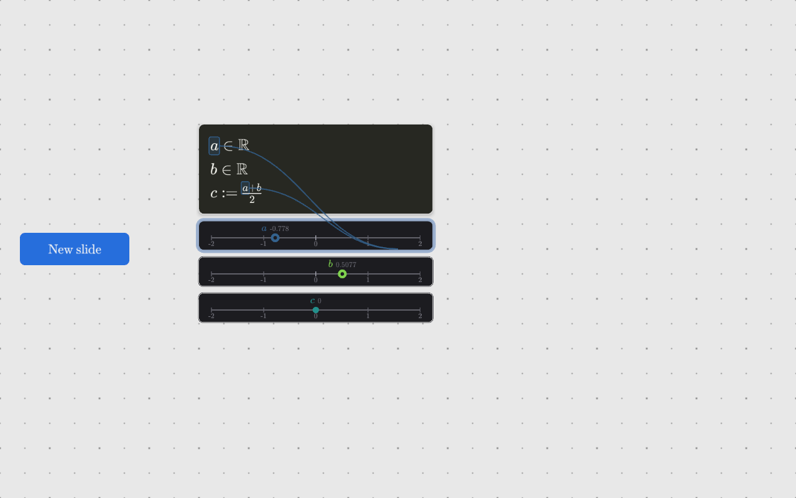

# sketchbook

An infinite pan/zoom canvas in C++20 on [raylib](https://www.raylib.com/), with
editable code boxes wired to a real C++ compiler, and a TeX maths typesetter.



## Building

raylib is pulled in by CMake at configure time, so the only prerequisites are a
C++20 compiler and CMake 3.20+. The first configure clones and builds raylib and
takes a few minutes; after that it is cached in `build/_deps`.

```sh
cmake --preset mingw        # MSYS2 GCC; use --preset default for MSVC
cmake --build --preset mingw
./build/sketchbook.exe
```

The `mingw` preset points at `C:/msys64` and drives the build with MSYS `make`,
so it does not need ninja or `mingw32-make`. Assets are copied next to the
executable after each build; the binary also falls back to the source tree, so
it runs from anywhere.

There is a canvas that demonstrates the lot -- reals and their knobs, functions
and their plots, a shader, an algebra, prose, a picture and a video, laid out as
a deck of six slides:

```sh
./build/sketchbook.exe --open C:/sketches/demo.sketch
```

Click a slide's rim to go to it, then use the left and right arrow keys to go
through the deck. Its picture and video sit beside it, and are named relative to
it, so the three of them move together.

## Using it

| Input | Action |
| --- | --- |
| Right-drag (or middle-drag) | Pan; the pointer becomes a closed hand |
| Drag one finger | Pan |
| Two-finger pinch | Zoom about the midpoint of the fingers |
| Wheel, or trackpad pinch | Zoom about the cursor -- or resize the window under it |
| Click a code box | Select it and put the caret where you clicked |
| Click anywhere else | Deselect, and rebuild if the text changed |
| Type with nothing selected | Start a new box in the middle of the view |
| `Ctrl`+`Enter` | Rebuild the selected box |
| Hover a line | Show it as code, with the injected value |
| `Ctrl`+`Z` | Undo, in the box being edited |
| `Ctrl`+`left`/`right` | Move the caret by word |
| Two-finger swipe left/right | Go through the deck, as in a browser |
| `Ctrl`+`S` / `Ctrl`+`O` | Save (back to the same file) / open a canvas |
| Drag a number-line handle | Choose that variable's value |
| Press a number line off its markers | Make a variable there and drag it |
| Hold two vizes, bring the fingers together | Make a third from the two of them |
| Right-drag a number line | Scroll that axis |
| Drag across a box's text | Highlight it |
| `Shift`+arrows, `Shift`+`Home`/`End` | Extend the highlight |
| Drag selected text out of the box | That variable gets an axis of its own |
| Wheel over a number line or plot | Zoom that window only |
| Right-drag, or two-finger drag, a space window | Orbit its camera |
| Wheel over a box or a picture | Resize it, about the corner nearest the pointer |
| Drag a picture's corner | Crop it |
| Drop a file on the window | A picture, a video, or a canvas to open |
| Hover or drag a number line or plot | Box its variable wherever it is written |
| Hover any window's edge | Its rim appears |
| Drag a rim | Move that window; drop it on another of its kind to merge them |
| Drag a window onto the cross | Close it |
| Click a slide's rim | Glide the camera onto that slide |
| `left`/`right` on a slide | Flick to the previous/next slide |
| Hover a slide's rim | A *delete slide* button appears in its corner |
| Drag the background | Lasso a selection |
| Left-click anywhere | Put the selection down |
| `Delete` | Throw the selection away |
| `Ctrl`+`C` / `X` / `V` | With a caret: the text. Without one: the selected boxes |
| Double-click a video's trim time | Type an exact time |
| `Esc` | Open/close the options menu |

Editing keys are the usual ones: arrows, `Home`, `End`, `Backspace`, `Delete`,
`Enter` (which carries the current indentation onto the new line) and `Tab`
(four spaces). `Ctrl`+`C`, `Ctrl`+`X` and `Ctrl`+`V` work on the highlighted
text, through the system clipboard, so text moves between this and other
applications; with no caret anywhere the same keys take the selected windows
instead. A press that moves more than a few pixels is a drag rather than a
click, so it does not move the caret.

The **right button pans**, and it does so wherever the pointer is — including
over a window that has claimed the wheel for its own scale. The left button
belongs to the contents of the canvas: clicking places the caret, dragging a rim
moves a window, dragging a handle chooses a value, pressing a number line puts a
new value there. That last one is why a number line is the one window that takes
the right button too, to scroll its own scale: its left button is entirely
spoken for. A box left completely empty is discarded when you click away.

Every window on the canvas -- code boxes, number lines, plots and pictures alike
-- is moved by the **rim** around its edge, which appears when you hover there.
Handles win over the rim, so grabbing a value never moves the row by accident. A
picture's crop corners and a paragraph's margin bar sit just inside that band
for the same reason. A rim is chrome rather than content, so it keeps the same
thickness in screen pixels at every zoom level and stays equally easy to hit.

A focused box grows one button above it: a **math/code toggle**. A text box
grows a strip instead -- bold, italic, one justification button that cycles
through left, centred and right, and a toggle
that shows its source -- and shows it whenever you reach for it rather than only
while it has the caret.

**Left-dragging the background draws a lasso**, and everything whose middle it
went round is selected. The loop closes with a **curve** rather than a straight
line: the gap between the pointer and where the stroke began is bridged by a
Bezier shaped by the first two and last two points of the stroke, so the closure
continues the gesture instead of cutting across it. What is caught is measured
against that same closed shape.

Selected windows wear their rim. A selection then behaves as one window: it
moves together, `Delete` throws it all away, and `Ctrl`+`C` / `Ctrl`+`X` /
`Ctrl`+`V` copy, cut and paste the boxes in it -- at the pointer, arriving
selected. A left click anywhere puts it down again -- on a window, on a picture
or on the bare canvas -- except the click that picks it up to carry it.

Everything on the canvas is a window -- a code box, a box of prose, a number
line, a plot, a shader's picture, a photograph, a video -- and every one of them
is carried by its rim, resized by the wheel, and thrown away the same way.
**Carrying a window brings up a cross at the foot of the app window**; drag onto
it and the window is absorbed, pull off and nothing has happened, let go and it
is gone.

Closing a **control** writes its value into the code. A number line for a free
variable is what chooses that value, so throwing it away has to leave the value
somewhere: `float a;` becomes `float a = 0.4;` and the box rebuilds. What was
injected is now yours. Closing a plot, a shader's picture, or a derived
variable's marker takes away the view and nothing else. Editing the literal back
out brings the knob back: a free variable always has somewhere to be moved
from.

The **grid only appears while it is being used** — while a window is being
carried or resized, and while the canvas is zoomed, since zoom is what decides
how fine the lattice is. It fades in, lingers half a second, and fades out
again, so reading a canvas means looking at a bare one.

There is **one dot per line of type** -- the spacing is the height of a line at
the default size, measured from the font -- so the grid is ruled paper and a box
put down has its lines in the gaps between rows of dots. What lands on a dot is
the box's first character rather than its corner, since the padding between them
is not a whole number of anything.

Every window **snaps to the nearest grid dot** -- to the grid as drawn, so
placement gets finer as you zoom in. Boxes additionally **never
overlap**: a box put down on top of another steps clear of it along whichever
edge is nearest, a whole dot at a time. The number lines and plots docked under
a box count as part of it, since they travel with it. Dragging, typing a new box
and loading a file all go through the same placement, so there is no way to end
up with a canvas that breaks either rule.

The Escape menu lists the canvases opened lately, most recent first; one click
goes back to one. The list is kept with your settings rather than in any canvas,
since it is a fact about you rather than about a canvas, and a file that has
moved or gone is left out rather than offered.

Canvases save and load from the Escape menu, or with `Ctrl`+`S` and `Ctrl`+`O`.
`Ctrl`+`S` writes straight back to wherever the canvas came from and only asks
when there is nowhere to go. A file can also be opened from the command line:
`sketchbook.exe path.sketch`. The format is plain text, one record per line, so
a canvas diffs and merges like source.

Two dev-only flags exist for capturing a frame without a human at the keyboard:
`--screenshot <file.png>` and `--frames <n>`, plus `--width`/`--height`.

## LaTeX and C++

The point of the program: **behind every piece of LaTeX there is compileable
C++**, and the LaTeX is generated from it. See CLAUDE.md for where this is
going.

A line of the mathematical subset has two readings. `float a;` is valid C++, and
it reads as `a ∈ ℝ`. `float c = (a + b) / 2;` reads as a real fraction. Lines
with no mathematical reading simply stay code, which is the designed fallback,
and the flip is per-line — a box can be part equation, part code.

Declarations stay abstract. To make them compile, an initialiser is **injected**
(`float a = -0.778;`), generated per type by an example generator, and never
part of your text. Hover a line to see it, in blue. Giving the box the caret
turns all of it into Monokai-coloured code and hides the injections: while you
are editing, what you see is your own text.

A line the compiler complained about always shows its code, so the red caret has
real characters to point at.

A box is sized for the **worst case across both readings**: the wider of its
LaTeX and its code, and the taller of the two for every row — whether or not
that row is the one currently showing it, so flipping a line never makes the box
taller. So flipping a line,
focusing the box, or dragging a knob never changes its shape. The slot kept for
an injected value is a fixed number of columns for the same reason -- sizing it
to the current number would make the box breathe as you drag.

Every variable has a **colour of its own**, from viridis, and everything that
stands for it wears it: its handle on a number line, its curve on a plot, its
name written beside either.

What lights up under the pointer is **the one thing it is on**: on a number line,
the marker nearest it. A derived marker lights up too — being read-only means a
press will not move it, not that pointing at it says nothing. What a press would
*take hold of* is a separate question, answered by the nearest **free** marker.
Nothing lights over the bare axis, where a press makes a new value instead.
Carrying a row by its rim lights all of it, since that is what you are holding;
a plot has nothing finer than the window itself, so hovering one lights every
curve.

It works from the other end too: **highlight a mention** of a variable in the
text and the same things light up — the name wherever else it is written, the
wires, and the viz blinking at the far end.

A **derived** value gets more than a wire: it gets its whole derivation. Point at
`d` where `float d = a + b * c;` and you see wires out of the *windows* of `a`,
`b` and `c` in their own colours, `b` and `c` meeting at a bullet marked `*`, a
black wire from there meeting `a` at a bullet marked `+`, and out of that, wires
in `d`'s colour to every place `d` is written and to `d`'s own windows. A wire
out of an operator is black because the working belongs to no one variable; a
literal gets no wire, since a number has nowhere to come from; and a call gets a
bullet with its own name in it. A bullet is flat at the back and pointed at the
front, and points at whatever it feeds — wires in at the flat end, one wire out
of the point, running a little way before it forks. The diagram hangs below the box and its windows,
where there is room for it.

Whichever it is, the variable's name lights up in the box it came from, in that
variable's colour, wherever it is written -- in the LaTeX or in the code,
whichever that line is showing, and on every line that mentions it -- with a
curve of the same colour running from the
**value itself** to each one: from that variable's handle on the number line,
not from your pointer. The handle is the variable; the pointer is only where
your hand is.

A name written more than once gets **one cable, not several**. The strands
gather at a junction just outside the card, level with the middle of the
mentions, and a single wire runs from there to the window — because however many
times it is written, it is one variable, and that is the whole claim the wire is
making.

Hovering a **shader's picture** lights up `fragTexCoord`, because that is what
the pointer is: the point the shader is being evaluated at, and the point its
number lines are read from. Colour says *which* variable; shape says whether it
is yours to move; and a **blink** — white, twice a second — says which one is in
use right now.

A box then gets **one number line** docked under it, carrying all of its reals
on one scale: free variables get a handle you can drag, derived ones a marker
that follows. The axis frames itself the first time everything on it has a
value, so all of them are in view — a stack of one-value axes would say nothing
about how they compare.

A variable is mutable unless it is `const`, so a window has to say *when*. With
no caret in the box it shows the value **at the end of the block**, which is
where every value is printed. Put the caret in the box and only the variables
written on that line keep their windows — or every variable the highlight
touches, if there is one; the rest of that box's windows stand down, since the
number they would be showing belongs to a line you are not looking at. They keep
their place rather than closing the gap, so nothing shuffles as the caret moves.
A shader's picture stays either way: it stands for the box, not for a variable.

To make a new variable, **press the axis where you want it**: anywhere on a
number line but on one of its markers. The box that axis belongs to blinks a
caret where the declaration will go — even when it is reading as mathematics,
since what is being pointed at is a line rather than a place between two letters
— and the press writes `float d;` there, with its knob already at the point you
pressed. It goes on the line the caret was last left on, or the end of the box,
and a blank line is written on rather than pushed down.

The press then **carries straight on into dragging it**, exactly as if the
marker had been there all along and you had grabbed it — which is why the
variable is declared free rather than written down as a number. Scroll the axis
on the **right button**, since the left one is now busy everywhere along it.

On a touchscreen, **hold two vizes at once** — a finger on each — and they
freeze at the values they had: two fingers on two handles is not two drags, so
whatever the first finger had started is undone. A wire follows each finger back
to its viz, in that value's colour. Bring the fingers together — halving the distance is
enough, since two fingertips can never report their centres closer than about
fifty pixels — and a little menu of `+` and `*` appears where they met. Keep a
finger down, slide it onto an option and lift, and `float c = a * b;` is written
at the caret; lift it anywhere else and the menu goes. Both must belong to the same box, since values of two
different programs could not be named on one line — two fingers spanning boxes
are a pinch, not a gesture.

To give a variable an axis of its own, **pull it out of the code**: select any
part of any mention of it and drag it out of the box. It comes away carrying
just that variable and lands where you let go. Drop one line's rim onto another
and they share a single axis — a way of seeing values together, not a claim that
they are equal. The merged axis **reframes itself**
around every value now on it, so both are in view with room at the ends; seeing
them together is the whole point of the gesture. The two need not come from the
same box: an axis belongs to the canvas. Each axis zooms and pans on its own
wheel, independently of the canvas.

## Display windows and vizes

The number line and the plot are **display windows** -- *dws*. A dw knows about
scales, panning, zooming, merging and being carried; it knows nothing about what
a real or a function looks like. What a value *looks* like is a **viz**:
`RealViz` is the marker on a number line, `RealFunctionViz` is the curve on a
plot.

A shader box's **picture is a viz too** — a full-screen quad for its mesh, with
all the work in a fragment shader. Saying so is what makes the shape general.

A viz answers four questions -- its **mesh**, where each vertex is **placed**,
how near the pointer counts as being on it, and what a drag means -- and the
first two can be written on the canvas itself. A box whose first line is
`Viz(float);` says how that type is drawn rather than declaring a value. Two
boxes per viz, paired by the type they name, and which is which needs no new
rule: a box is C++ first and GLSL if C++ refuses it.

```
Viz(float);                                Viz(RealFunction);
for (int i = 0; i < 20; ++i) {             float px = value(-8.0f), py = -8.0f;
  float s = 6.2832f * i / 20.0f;           for (int i = 1; i < 129; ++i) {
  float e = 6.2832f * (i + 1) / 20.0f;       float y = -8.0f + 16.0f*i/128.0f;
  vertex(7 * cos(s), 7 * sin(s));            float x = value(y);
  ...                                        line(px, py, x, y);
}                                            px = x; py = y;
                                           }
```

The **C++ half turns a value into geometry**, with `vertex(x, y)` for triangles
and `line(ax, ay, bx, by)` for a path — and it runs *inside the program that has
the value*, because a `std::function` cannot leave the process that made it. So
sampling and building the mesh are the same editable snippet, and they cost
nothing: that program was going to run anyway, and the vertices ride back with
the values.

The **GLSL half places it** — the vertex shader, handed `p` in the viz's own
units and expected to leave it in screen pixels. It gets `value`, `sbArea`,
`sbView`, `sbScale` and `sbMap`, which takes value space to screen. That makes
the placing half one line: `p = sbMap(vec2(value, 0.0)) + p * sbScale;` for a
marker, `p = sbMap(p);` for a curve.

A viz box *starts* as code rather than as mathematics, since there is no equation
reading of a mesh — but the math/code toggle is there as on every code box, and
only a `\text` box lacks it.

Open `C:\sketches\viz.sketch` and change a number in any of the four boxes. A
type with no viz boxes keeps the drawing the app was born with, so nothing has to
be authored for a canvas to work.

## Slides

A slide is a **region of the canvas with a permanent rim** round it, not a
separate document. Click the **New slide** button (on the canvas, just left of
where the camera opens) and a slide appears with a title and some body text; the
camera glides to frame it, and the button walks along to sit in the gap just
past it. Clicking again puts the next slide beyond that one, clear of it with
the same gap between them — so a deck grows **left to right**, and the button is
always at the end of it rather than out in the middle of where the next slide
will be.

Click a slide's rim and the camera glides until that slide fills the window --
presenting is navigating. Once it is framing one, **left and right flick through
the deck**, instantly -- and so does a **two-finger swipe**, sweeping left to go
forward, the way a browser goes back and forward. On a touchpad that is
Windows' own horizontal-wheel signal rather than anything recognised here; which slide follows which is decided by nothing but where
they sit. A slide's inside is left alone, so everything on one stays usable. The deck's
shape is set in the Escape menu -- 3:2, 16:9, 4:3 or 1:1 -- under a heading that
is folded away until asked for, since a deck's shape is chosen once and then
left alone. It starts at **3:2**, which is also the shape the app window opens
at, so a slide seen at its own scale is exactly a screenful.

A slide owns nothing but its rim: the title and the body it arrives with are
ordinary **text boxes** on the canvas, which you can move, edit, resize and
throw away like anything else. A slide itself does not move -- it is a place,
not a container -- so clicking one does the only thing it does, which is take
the camera there.

Point at a slide's rim and a **delete slide** button appears in its bottom-right
corner. Click it and the slide goes, taking everything whose middle is on it --
the same test the lasso uses. The deck then closes the gap: every slide to the
right comes back by one slide, with its contents and with the **New slide**
button.

## Words, pictures and video

A box whose first line starts with `\text` is **prose** rather than code. The
sigil is the whole switch -- write it and the box sets its lines as words on the
bare canvas, with no card behind them. Boldness, italics and justification
belong to the box and are chosen from the strip of controls above it, so there
is no markup to learn and nothing to get half-applied.

A text box is **written in as words**: click between two letters of the typeset
line and that is where the caret goes. The strip's last control shows the source
instead, sigil and all, which is how a text box stops being one; the caret keeps
its place across the switch. That toggle stays where it is put -- a box can be
left reading as its own source, and it is saved that way. Only the *button* goes
when the box stops being pointed at.

Prose **wraps to a measure** -- the bar just inside the right edge is the right
margin, and dragging it sets how far the words run. A box that has never been
given one takes about sixty characters. The measure scales with the type when
you resize the box, so resizing makes the words bigger rather than reflowing
them, and the arrow keys move by row rather than by line.

**Drop a picture or a video on the window** and it becomes a window where the
pointer is; the Escape menu has *Insert picture or video* for when there is
nothing to drop with. Dropping a `.sketch` opens it.

Dragging a **corner** of a picture crops it: the frame moves and the picture
stays where it is, so what changes is how much of it you can see. Resizing is
the wheel's job, and the two never share a pixel -- the corner handles sit just
inside the rim's grab band.

A video gets a **transport**: play, a bar showing where it has got to, and two
markers for where the clip starts and stops. Double-click a marker's time to
type an exact one. Playback loops between them. Frames come from `ffmpeg`, read
off a pipe on a worker thread as they arrive, so nothing is decoded to disk and
nothing is held in memory but the next few frames; if `ffmpeg` is not on the
path the window says so rather than showing nothing.

## Resizing

The **wheel over a window resizes it** uniformly -- one number for both
dimensions, so nothing is stretched. For a box of code or prose that is the type
size; for a picture it is how big the picture is. The corner nearest the pointer
stays put, so the window grows away from your hand.

Prose and pictures **snap to their neighbours**: every window near the one being
resized offers its height and its width, and if either is close to the size
being asked for it is taken exactly. That is how two pictures come to be exactly
the same height, or a caption exactly as wide as the box above it. Code boxes
resize without snapping, but are offered as targets.

## Clifford algebras

A box can work in a geometric algebra, generated as plain C++ -- concrete
structs and concrete products, unrolled, no templates. `Algebra(3,0,1);` on a
line of its own chooses the signature (p squaring to +1, q to -1, r to 0); with
nothing said it is Cl(3,0,1), 3D projective geometric algebra, with `e0` null.

Types are named by grade: `Una` (grade 1), `Bi`, `Tri`, `Even`, `Odd`,
`Multivector`, and compounds like `ScalarQuad`, written ascending.

The `Algebra` line reads as the sentence that names the algebra -- **A =
Cl^{3,0,1}**, in a script A -- and every type after it is said in terms of that
name: an exterior power for a single grade, **A⁺** and **A⁻** for the even and
odd halves, **A** for the whole of it, and a direct sum for a compound. Because a
type is a set of *grades*, every product has an exact result type with a name --
nothing is widened to `Multivector` to make things fit.

| C++ | means | reads as |
| --- | --- | --- |
| `a * b` | geometric product | `ab` |
| `a \| b` | inner product | `a · b` |
| `a ^ b` | outer product | `a ∧ b` |
| `a & b` | regressive product | `a ∨ b` |
| `~a` | reverse | `ã` |
| `!a` | dual | `a*` |

`grade2(M)` takes the grade-2 part of a value, and reads as **⟨M⟩₂** -- with the
subscript always shown, including `⟨M⟩₀` for the scalar part. Only the grades a
type has get a selector, so asking an `Even` for its grade 3 is a compile error
rather than a silent zero.

The algebra is written for **GLSL** too, so a shader box can use it. GLSL has no
operator overloading, so there the products are the named functions `gp`, `ip`,
`op`, `rp`, `rev`, `dual`, `add`, `sub`, `div` -- which exist in C++ as well, and
read identically (`op(p, q)` sets as `p ∧ q`). Operators are a convenience;
the function spelling is the one that runs in either language.

C++ binds `|` and `^` looser than `+`, so `a + b | c` is `(a + b) | c`; write
the brackets. Only the types a box mentions are written out, plus whatever the
products between them need, so an ordinary box of floats pays nothing.

```
Algebra(3,0,1);
Una p;
Una q;
Bi L = p ^ q;
float d = p | q;
```

## Two languages

A box is **C++ by default**. If the C++ compiler refuses it, the same lines are
tried as **GLSL**, because a box that says `vec2 p = fragTexCoord;` was never
trying to be C++. Nothing declares the language; a box is whichever one will
have it.

Either way the app supplies the ends and you write the middle. For C++ that is
the includes, the argv reader and a `main` that prints every value back; for
GLSL it is the fragment-shader interface, one `uniform float` per knob, and a
`void main() {` ... `}` around your lines. A free real reaches a program through
argv and a shader through a uniform, so **a knob drives either without
rebuilding** -- one re-runs the executable, the other just draws the next frame.

A box that compiles as a shader draws itself in a square beside the card. Lines
with no mathematical reading stay as code, so a shader box is usually part
equation and part GLSL.

Its derived variables still reach their number lines: a second shader, the same
lines with different ends, renders each one's bits into a pixel of a one-row
target that is read back. Inside a fragment shader a variable is a field rather
than a number, so it is read **at a point** -- the one under the pointer while
you are over the picture, its middle otherwise. Move the mouse across the
preview and the number lines follow the field.

## Functions

A `float` is a real; a `RealFunction` is a function from reals to reals. It is
`std::function<float(float)>` with the vector space operations added, so it is
exactly what a C++ programmer already means by one:

```cpp
RealFunction f;                                  f : R -> R
RealFunction g = [](float x) {                   g(x) = sin(1.4x)
    return sin(1.4f * x); };
RealFunction h = f + 2 * g;                      h = f + 2g
```

A declaration with no initialiser gets an example the same way a real does, only
the example is a lambda rather than a number -- a wave, a parabola, a bump or a
line -- shown in blue when you hover the line.

Each function gets a **plot** as well as a number line, drawn from samples the
program prints back. **Input runs up the vertical axis and output along the
horizontal one**: the transpose of the usual convention, chosen because these
axes are going to become spacetime diagrams. Both axes share one scale, so the
window is square and a slope of one is a diagonal. Drop one plot's rim onto
another and both curves share a set of axes, each named in its own colour --
which is what a vector space looks like.

A function also gets a **row on a number line**, where it is drawn as an
opacity field: transparent at zero, opaque viridis green at +1 and opaque
viridis yellow at -1, clamped rather than rescaled beyond either, so the colour
means the same number on every axis. Off the end of what was sampled nothing is
drawn at all. Each function starts on a row of its own -- two fields on one row
would paint over each other -- and dropping one row onto another puts them on
one scale. That is a *second* viz for one type: a viz box can name the window it
is for, `Viz(RealFunction, Axis)`, and the two are kept apart.

Dragging a knob does **not** recompile. The box is built once, its free
variables are passed in as arguments, and every value is printed back, so a drag
costs one process launch of a few milliseconds. Recompilation happens only when
the code changes.

## The built-in compiler

A box that declares no variables of its own falls back to older behaviour: it is
a translation unit that should define `bool testFunc()`, and the square beside it
shows the answer — **red** for `true`, **blue** for `false`, neutral grey while
building or when there is nothing truthful to report. This predates the LaTeX
direction and is kept only until it is in the way.

Either way, a box is rebuilt when you deselect it (only if the text actually
changed) or when you press `Ctrl`+`Enter`.

`compiler.cpp` appends

```cpp
int main() { return testFunc() ? 0 : 1; }
```

builds a real executable, and runs it **out of process**, reading the answer
back from the exit code. Two things fall out of that. Nothing is *prepended*, so
a diagnostic at line N of the generated file is at line N of the box and error
positions map straight onto the caret. And because the code on the canvas runs
in its own process, an infinite loop or a null dereference in it cannot take the
app down — those come back as `Crashed` (there is a 5s watchdog on the run and
25s on the build).

Builds happen on a worker thread and are collected by `CodeBlock::Poll`, so the
canvas keeps panning at full rate while g++ works.

When compilation fails, the earliest error is shown in a white balloon, black
text, in a proportional face at 75% of the code size, with its top-left corner just below
the offending character and a red caret marking it. Parsing the `file:line:col:
error:` prefix works backwards from the `: error:` marker, because a Windows
path has colons of its own.

The compiler is found at first use: `$SKETCHBOOK_CXX` if set, then `g++` and
`clang++` on `PATH`, then the usual MSYS2/MinGW install locations — the app is
normally launched from a shell that never had MSYS2 on `PATH`. If none is found
the boxes say so rather than silently doing nothing.

## How it works

### Touch

raylib's `GetTouchPointCount()` only carries real data on Android and web. On
the Windows desktop backend GLFW synthesises a single touch point from the
mouse, so a two-finger pinch is invisible to it and pinch-zoom cannot be built
on raylib's touch API alone.

`src/touch_win32.cpp` therefore subclasses the window procedure and reads
`WM_POINTER` messages, which is how a Win8+ app gets genuine multi-touch. The
`GetPointerType`/`GetPointerInfo` entry points are resolved with
`GetProcAddress` rather than linked, so the binary still starts on an older
system (it just falls back to mouse-only input). That file never includes
`raylib.h`: `<windows.h>` also declares `Rectangle`, `CloseWindow` and
`ShowCursor`, and the two headers cannot coexist in one translation unit.

Legacy mouse events synthesised from touch are deliberately passed through
rather than swallowed, so a finger tap still reaches raylib's mouse API and can
work the menu. The viewport ignores mouse panning while any finger is down, with
a short cooldown after the last one lifts, so a pan is never applied twice.

Note that `FLAG_WINDOW_HIGHDPI` is deliberately *not* set. GLFW is already
per-monitor DPI aware, so the window is sized in real pixels either way; turning
the flag on adds `GLFW_SCALE_TO_MONITOR`, which leaves the draw space scaled by
the monitor factor while `GetMousePosition()` keeps reporting unscaled
coordinates. With it off, screen size, render size, mouse position and the
`WM_POINTER` coordinates are all the same pixel space.

### Staying sharp under zoom

raylib rasterises a font atlas at one fixed pixel size, so a 16px atlas blown up
to 400px is mush. Nothing here is drawn through `BeginMode2D`; the canvas
transform is applied on the CPU (`Viewport::ToScreen`) and the zoom is folded
into the *font size* instead of into a matrix.

`FontStore` keeps a small LRU cache of atlases on a size ladder
(16/24/32/48/64/96/128px em) and hands back the rung nearest the size actually
being drawn, so glyphs are always rasterised close to their final size.

One subtlety worth knowing: raylib's `fontSize` argument is a stbtt pixel
*height* — ascent to descent — not an em, and the faces disagree on that ratio.
Asking every face for "size 48" would silently set Main and Math-Italic at
different scales, so the store reads `head`/`hhea` out of each TTF itself and
converts the em it wants into the per-face size that yields it.

### The maths

`src/tex/` is a real implementation of TeX's box-and-glue model for maths mode,
not string substitution:

- Atoms are classified Ord/Op/Bin/Rel/Open/Close/Punct/Inner, and inter-atom
  spacing comes from TeX's table in chapter 18 of *The TeXbook*. Binary
  operators are reclassified as ordinary when they cannot be binary — a leading
  minus, or one operator straight after another — which is why `-x` is set
  tighter than `a - x`.
- Fractions, radicals, scripts and limits are positioned with the Computer
  Modern σ/ξ font parameters (`texparams` in `fontstore.h`).
- `\left(`…`\right)` grows a delimiter by choosing among the Size1..Size4 cuts,
  then centres it on the maths axis.

Supported: the symbol set in `tex_symbols.cpp` (Greek, operators, relations,
arrows, AMS extras), super/subscripts with proper limit placement on big
operators, `\frac` `\dfrac` `\tfrac` `\binom`, `\sqrt` with an optional index,
`\left`…`\right`, `\big`..`\Bigg`, accents, `\overline`, `\underline`, `\text`,
`\operatorname`, the `\math*` alphabet switches, explicit spacing, style
switches, and the `matrix`/`pmatrix`/`bmatrix`/`vmatrix`/`cases` environments.

Every codepoint/face pairing in the symbol table was checked against the actual
cmaps of the bundled fonts, so a lookup that succeeds is guaranteed to
rasterise. `\neq` and `\notin` are the exceptions — no glyph for them exists
anywhere in the font set, so they are built as `\not` applied to `=` and `\in`,
which is what KaTeX does too.

Parsing is forgiving by design: an unknown command is drawn as upright literal
text and reported through `Layout::error` rather than blanking the formula.

Known gaps: there is no blackboard-bold face, so `\mathbb` falls back to bold;
and italic correction is not applied before a superscript, because raylib's
glyph metrics do not expose it. Maths boxes are display-only — editing is code
boxes for now.

## Other known gaps

- Closing the window while a build is in flight leaves the process alive until
  the compiler exits, because the pending `std::future` is joined on shutdown.
  Builds are normally well under a second.
- Only GCC and Clang diagnostics are parsed. MSVC uses a different format and
  needs a `vcvars` environment, so it is not attempted.

## Layout

```
src/
  main.cpp        entry point, window setup, frame capture
  app.{h,cpp}     scene, focus and input routing
  viewport.*      pan/zoom camera and gesture handling
  touch.*         multi-touch front end
  touch_win32.*   WM_POINTER backend (no raylib.h in here)
  process.*       child process: run one, or read one as it goes (no raylib.h)
  video.*         frames out of ffmpeg, on a worker thread (no raylib.h)
  compiler.*      toolchain discovery, build/run, diagnostic parsing
  mathline.*      the C++ subset: one line -> LaTeX + what it declares
  mathprogram.*   assemble a box into a program, build it, re-run it on values
  types/          one directory per supported type -- the extension point
    RealFunction.*      the type: the C++ the app injects, and how one prints
    RealFunctionViz.*   its plot, and its example generator
    RealViz.*           a real's number line, and its example generator
    examples.h          the generators, declared away from raylib
  highlight.*     Monokai colouring for a line of C++
  filedialog.*    native open/save dialogs (no raylib.h in here)
  grid.*          the dotted grid
  blocks.*        the editable card: code, its maths reading, and prose
  media.*         pictures and video as windows: crop, transport, playback
  resize.*        the wheel-resize rule and how it snaps to neighbours
  selection.*     the lasso, and what it catches
  ui.*            the options menu
  recent.*        the canvases opened lately, kept between runs
  glslops.*       operator overloading for GLSL, which has none
  glext.*         the few GL entry points raylib does not hand over
  fontstore.*     face registry, size-ladder atlas cache, TTF metrics
  text.*          plain-text measure/draw/wrap on top of FontStore
  tex/
    tex.h           AST, layout and drawing interface
    tex_parse.cpp   recursive-descent parser
    tex_layout.cpp  TeX box model, spacing table, drawing
    tex_symbols.cpp symbol/accent/operator tables
assets/fonts/     Computer Modern (via KaTeX) and JetBrains Mono, both OFL
```

## Licence

The bundled fonts are OFL; see `assets/fonts/LICENSES.md`. raylib is zlib/libpng.
